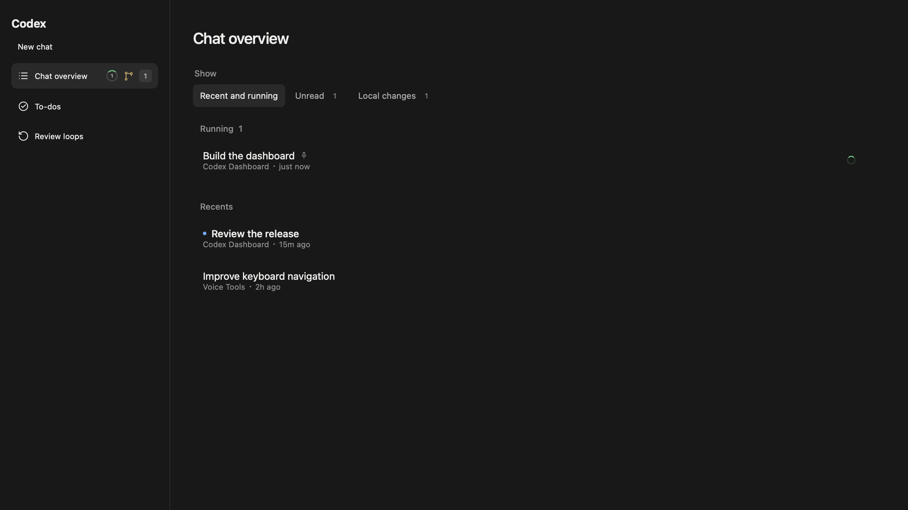

# Codex Dashboard

[](https://github.com/MrLawrenceAwe/Codex-Dashboard/actions/workflows/ci.yml)

A native macOS menu-bar utility that brings chat activity, unfinished work and project changes into one dashboard inside Codex.

**Stack:** Swift 6, AppKit, JavaScript, XCTest and WebKit.

This is an independent personal project and is not affiliated with OpenAI.



*Screenshot from the automated visual test fixture; all chats and projects are synthetic.*

## Features

- **Chats:** activity, unread status, completion and question tracking.
- **Projects and Git:** a shared local project list across account windows, sidebar colours, change indicators, and native Commit, Commit & push, and Push shortcuts.
- **Accounts:** saved-account switching, independent separate account windows, allowance tracking, reset countdowns, and macOS or optional ntfy phone alerts.

- **Review loops:** queued reviews and automatic fixes for repositories or ordinary folders, with model choices, verification, and optional Git commits and pushing.
- **Dictation:** dictate into sent-message edits using your existing sign-in.
- **Prompts and to-dos:** reusable prompts and persistent tasks with tags, projects, images, and model settings.

Normal ChatGPT launches use their native app-server. The old shared-chat mode and
its login-session routing have been retired after a startup failure. On upgrade,
Dashboard archives its old routing metadata after checking that the old writer
has stopped. Chats and credentials stay in their original locations. Separate
account windows have independent histories. The experimental shared-chat broker
accepts only isolated managed storage and is unavailable from the Dashboard UI.

See [Using Codex Dashboard](docs/usage.md) for feature behaviour and controls.

The DevTools connection is limited to the local machine. New Codex launches use a new
high port; Dashboard reuses that port when reconnecting to the running Codex process.
Chromium DevTools does not authenticate local clients.
Use this utility only on a trusted personal macOS account; do not leave Codex running
with the dashboard enabled when untrusted local software has access to your account.

## Install

Requires macOS 14+, the Codex desktop app, and a Swift 6 toolchain.

Run:

```sh
./install.sh
```

The installer runs `swift test`, builds and signs the app, and installs it in
`$HOME/Applications`, restoring the previous bundle if replacement or verification
fails. Add `--relaunch` to open the new build or `--skip-tests` for local iteration.
The default is `--no-launch`.

Local installs reuse a **Codex Dashboard Local Development** signing certificate.
Choose **Always Allow** when the signed helper first requests access to each saved
account. Approvals persist across Dashboard-only rebuilds; helper or certificate
changes may require approval again.

If the login keychain password is unavailable, run
`python3 Packaging/signing-keychain.py --create` once, then rerun the installer.
This creates a separate signing keychain for later installs to reuse.

To use an existing signing certificate, set `SIGNING_IDENTITY` to its name or SHA-1
fingerprint. See [local signing](docs/development.md#local-signing) for details.

Run `./uninstall.sh` to move the installed app to the Trash.

## Use

1. Open **Codex Dashboard** from `$HOME/Applications`; it appears in the menu bar.
2. Finish any active response in Codex.
3. Select **Restart & Enable**, or leave Codex in the background with no running chats to enable it automatically.
4. Select **Chat overview** in the Codex sidebar.

Keep Dashboard running to refresh activity and restore its controls after Codex
reloads. Use the menu bar for Diagnostics, Launch at Login, automatic completion and question
focus, and **Disable dashboard integration**.

## Development

Run `swift test` for native and WebKit tests and
`node --test Tests/Renderer/*.test.cjs` for renderer checks. CI uses macOS 26 and
Xcode 26.6 for visual baselines.

See [architecture](docs/architecture.md) for runtime and storage,
[development and testing](docs/development.md) for previews and visual baselines,
and [review-loop controls](docs/usage.md#review-loops) for recovery and testing rules.
